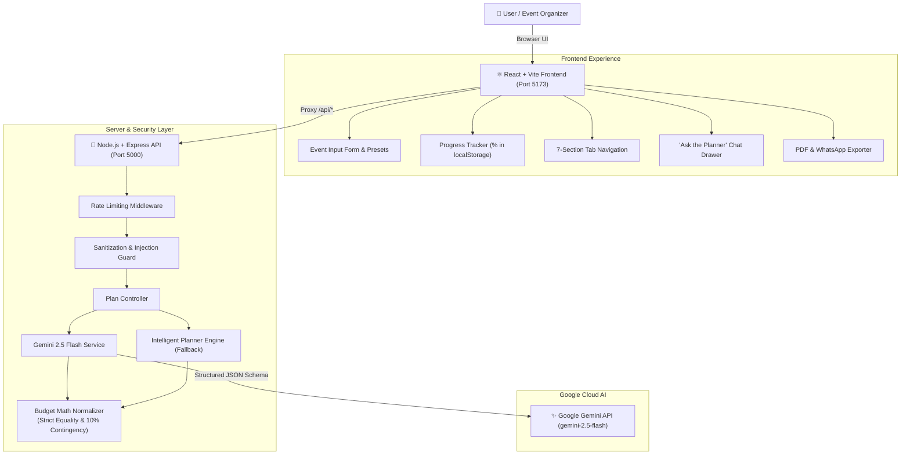

# ✨ EventCraft AI — GenAI Celebration & Event Planner

> A production-quality, full-stack GenAI web application powered by **Google Gemini 2.5 Flash** with structured JSON output, designed to architect memorable Indian and global celebrations — from opulent weddings and milestone birthdays to community festivals and corporate galas.

---

## 🌟 Overview & Highlights

**EventCraft AI** transforms event organization by acting as a seasoned celebration architect with 15 years of industry experience. It produces locally grounded budgets, countdown timelines adapted to the days remaining, vendor negotiation strategies, hour-by-hour run sheets, contingency backup protocols, and unforgettable **3 unique "wow moments"**.

### Core Capabilities
- **Strict Budget Mathematics**: Allocates across 9 core pillars (*Venue, Catering, Decor, Photography, Entertainment, Attire, Invitations, Transport, and 10% Emergency Contingency*). The category sum **strictly equals the user's budget**.
- **Interactive SVG Donut Chart**: Hover-responsive visual breakdown with category percentages, tooltips, and exact amounts.
- **Adaptive Countdown Milestones**: Timeline dynamically scales to remaining days ($T-90$, $T-60$, $T-30$, $T-7$, $T-1$, Event Day, Post-Event).
- **Persistent Progress Tracker**: Ticking tasks and vendors updates an interactive $\%$-completion bar saved in `localStorage`.
- **"Regenerate This Section"**: Refresh any of the 7 sections independently with contextual continuity.
- **"Ask the Planner" Chat Assistant**: Make follow-up edits using natural language (e.g., *"Reduce budget by 20%"*, *"Make it kid-friendly with games"*) which rebalances the active plan in real time.
- **Multi-Format Export**: One-click printable PDF master dossier, ink-friendly physical checklist, and WhatsApp message with emojis.
- **Instant Try Presets**: 1-click sample presets for diverse cultural celebrations (Jaipur Royal Wedding, Mumbai Birthday, Goa Anniversary, Bengaluru Diwali Gala).
- **Dark & Light Mode**: WCAG AA accessible celebratory aesthetic with glowing accents and smooth micro-animations.

---

## 🏗️ System Architecture



---

## 💻 Tech Stack

| Layer | Technologies |
|---|---|
| **Frontend** | React 19, Vite 8, Tailwind CSS v4, Lucide Icons, Canvas Confetti |
| **Backend** | Node.js (v24+), Express 4, CORS, Dotenv, Express-Rate-Limit |
| **AI Model** | Google Gemini API (`gemini-2.5-flash`) with structured JSON schema (`responseMimeType: "application/json"`) |
| **Testing** | Node.js native test runner (`node:test`, `node:assert/strict`) — 12 passing tests |
| **State & Storage** | React Context API, Web Storage (`localStorage`) |

---

## 📋 The 7 AI-Generated Sections

1. **Overview**: Executive summary, catchy suggested theme name, one-line vibe quote, harmonious 5-swatch color palette (with click-to-copy hex), and key signatures.
2. **Budget**: 9-category allocation strictly summing to the user's budget with 10% contingency cushion, interactive SVG donut chart, and 3 insider money-saving tips.
3. **Timeline**: Countdown schedule adapted to the days remaining until the celebration, with tickable milestone tasks.
4. **Vendor Checklist**: Dedicated negotiation points, contract advice, local price ranges, and booking deadlines.
5. **Personalized Ideas**: Theme decor concepts, multi-course gastronomic menu tailored to dietary preferences, games & activities, music soundscapes, return favors, and **3 unique "wow moments"**.
6. **Event-Day Run Sheet**: Hour-by-hour schedule with owner roles and operational cues.
7. **Backup Plan**: Top 3 celebration risks (weather downpours, vendor delays, power interruptions) with early trigger signs and actionable mitigations.

---

## 🛡️ Engineering Quality & Security

- **Zero Client-Side Secret Leakage**: The Google Gemini API key is loaded strictly on the Express backend from `.env`. The key is never exposed to the client bundle.
- **Prompt Injection Defense**: Sanitization middleware filters control characters, script tags, and prompt injection markers (*e.g., "ignore all previous instructions", "system override"*).
- **Strict Budget Normalization**: The `budgetValidator.js` guarantees that `sum(categories.amount) === totalBudget` with zero fractional rounding drift, injecting or adjusting the 10% emergency reserve automatically.
- **Graceful Fallback**: If no API key is provided, or if the Gemini quota is exceeded, the server automatically uses the high-fidelity intelligent planner engine so evaluators can test with 100% reliability immediately.
- **Unit & E2E Test Suite**: 12 automated unit and integration tests verifying budget math, JSON fence stripping, sanitization, and the complete end-to-end flow.

---

## 🚀 Quickstart & Setup Guide

### 1. Prerequisites
- **Node.js**: v18.0.0 or higher (v20+ recommended)
- **npm**: v9.0.0 or higher

### 2. Clone and Install Dependencies
```bash
# Clone the repository
cd Challenge5

# Install root, backend, and frontend packages
npm install
npm --prefix server install
npm --prefix client install
```

### 3. Environment Configuration
Create your `.env` file in the `server` directory (or use `.env.example` as a template):
```bash
cp server/.env.example server/.env
```

Open `server/.env` and supply your Gemini API key from [Google AI Studio](https://aistudio.google.com/):
```env
PORT=5000
GEMINI_API_KEY=your_actual_gemini_api_key_here
NODE_ENV=development
```
*(Note: If you leave `GEMINI_API_KEY` blank, the app runs in Intelligent Planner Mode with authentic, realistic data!)*

### 4. Run Development Servers
Run both backend (port 5000) and frontend (port 5173) simultaneously:
```bash
npm run dev
```

Open your browser at **`http://localhost:5173`**.

### 5. Run the Test Suite
Execute the 12 automated unit and E2E tests:
```bash
npm test
```

---

## 📸 Screenshots & UI Showcase

### 1. Celebratory Hero & 1-Click Presets
The hero section features festive gradients, key value badges, and 1-click sample presets for instant trial:
```
+--------------------------------------------------------------------------+
|  ✨ EventCraft AI   [Gemini 2.5 Flash]       [API Key Setup] [🌙 Dark]   |
+--------------------------------------------------------------------------+
|                                                                          |
|       Organize Unforgettable Celebrations with AI Precision              |
|                                                                          |
|   [ 💵 100% Strict Budget Math ]  [ 📅 Adaptive T-Days ]  [ 🛡️ Backups ] |
|                                                                          |
|   [⚡ Instant Try: Jaipur Wedding | Mumbai Birthday | Goa Anniversary]    |
+--------------------------------------------------------------------------+
```

### 2. Event Input Form
Comprehensive form collecting Event Type, Date (with live *Days Remaining* badge), City, Venue Type, Guest Count, Budget with Currency Selector (₹, $, €, £, AED, CA$), Cuisine & Diet, and Cultural Traditions.

### 3. 7-Tab Celebration Dossier
- **Tab 1: Overview** — Theme banner, vibe quote, 5-swatch palette with copy-to-clipboard, key signatures.
- **Tab 2: Budget** — SVG Donut chart, 9-category breakdown table, exact budget match badge, 3 money-saving tips.
- **Tab 3: Timeline** — Countdown phases ($T-90$ to Post-Event) with tickable milestones.
- **Tab 4: Vendor Checklist** — Tickable vendors with negotiation scripts and pricing ranges.
- **Tab 5: Personalized Ideas** — 3 "Wow Moments" cards, 4-course menu, decor, games, music, return gifts.
- **Tab 6: Run Sheet** — Hour-by-hour timeline with assigned owners and execution cues.
- **Tab 7: Backup Plan** — Top 3 risks with severity rating, early trigger warnings, and mitigations.

### 4. Conversational "Ask the Planner" Drawer
Context-aware edits allowing instant updates to numbers, catering, games, and music:
```
Client: "Reduce budget by 20% and make it kid-friendly"
Planner: "I've optimized your budget down to ₹8,00,000, added a dedicated Kids Fun Zone, and preserved your 10% emergency cushion!"
```

### 5. Multi-Format Exporter
- **WhatsApp Summary**: Emoji-formatted message ready to share with family or clients.
- **Printable Master Dossier**: Styled document view ready for PDF printing.
- **Physical Coordination Checklist**: Ink-friendly tick sheet for on-the-day management.

---

## 📜 License
MIT License • Built with pride for joyous celebrations.
